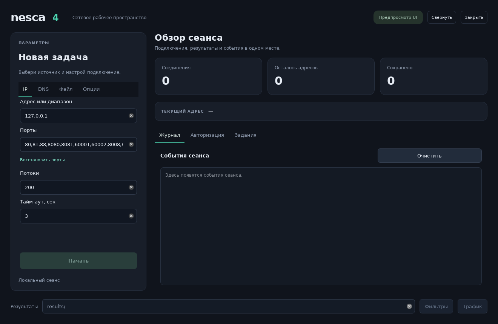

# NESCA 4

Переработка NESCA на C++ и Qt: современный интерфейс, исправления ошибок памяти и постепенное приведение старого ядра к сопровождаемой архитектуре.



## Текущее состояние

Новая форма интерфейса подключена к существующим обработчикам приложения. Вместо фиксированного окна 500 пикселей используются масштабируемые Qt-layout’ы: настройки слева, сводка и журнал справа, вкладки авторизации и заданий. Добавлены единая тёмная тема, читаемые шрифты, видимые состояния фокуса, скрытие ключа доступа и обычная рамка окна с изменением размера. В исходном коде автозапуск старых удалённых проверок версии и почтового сервера отключён.

**Сейчас проверена сборка автономного предпросмотра `nesca4-ui` и регрессионных тестов.** Предпросмотр использует ту же `.ui`-форму и тему, но не подключает сетевое ядро; кнопки сетевых действий в нём отключены. Это позволяет проверять дизайн и работу layouts отдельно от старых потоков и зависимостей.

Полная сборка и работа старого сетевого приложения после интеграции новой формы пока не подтверждены. Это ранняя версия разработки, а не готовый стабильный релиз. Открытые проблемы и границы проверки перечислены в [техническом аудите](docs/AUDIT.md).

## Сборка интерфейса и тестов

Нужны CMake 3.16+, компилятор C++17 и Qt 5.12+ с Core, Gui, Widgets и инструментами разработки. Для Ubuntu/Debian пакет Qt — `qtbase5-dev`; для сборки также нужны `cmake` и `g++`.

```bash
cmake -S . -B build -DCMAKE_BUILD_TYPE=Debug
cmake --build build --parallel 2
ctest --test-dir build --output-on-failure
./build/nesca4-ui
```

В Windows с установленным Qt и настроенным компилятором используются те же команды CMake; исполняемый файл обычно находится в `build/Debug/nesca4-ui.exe`. Сборка Windows ещё не проверена.

Снимок настоящих Qt-виджетов без дисплея:

```bash
QT_QPA_PLATFORM=offscreen ./build/nesca4-ui --smoke --screenshot docs/interface.png
```

Проверка UI переключает четыре вкладки параметров и три вкладки результатов на размерах 1060×740, 1320×860 и 1600×1000, проверяет положение кнопки закрытия и сохранение введённого адреса. Два других теста проверяют строковые функции и ограничение входного буфера. Все три теста прошли на Linux с GCC 15.2 и Qt 5.15.18.

## Структура

- `src/nesca_3.ui` — новая форма Qt Designer с сохранёнными именами элементов старого приложения.
- `src/ModernTheme.h` — единая тема Qt Widgets.
- `tools/ui_preview.cpp` — самостоятельный предпросмотр без сетевого ядра.
- `src/` — исходники ядра с первыми исправлениями памяти и интеграцией новой формы.
- `tests/` — регрессионные проверки.
- `docs/` — аудит, происхождение исходников и снимок интерфейса.

Старые qmake-файлы в `src/` сохранены для дальнейшей миграции ядра. Они зависят от старого окружения и не являются проверенным способом сборки NESCA 4. Исторические README и Dockerfile вынесены в `docs/UPSTREAM_*`; их команды относятся к исходному проекту.

## Происхождение

Основано на [pantyusha/nesca](https://github.com/pantyusha/nesca) и [dnet44/nesca-remaked](https://github.com/dnet44/nesca-remaked). Исходные авторы и точные версии указаны в [THIRD_PARTY.md](THIRD_PARTY.md). Существующие уведомления об авторстве сохранены; новая лицензия для чужих исходников не назначалась.
